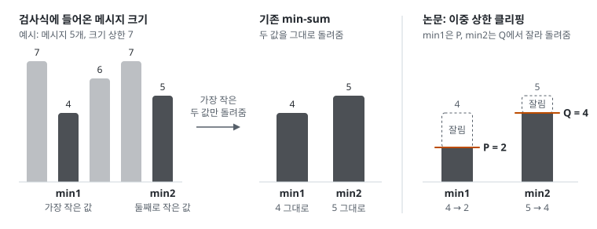
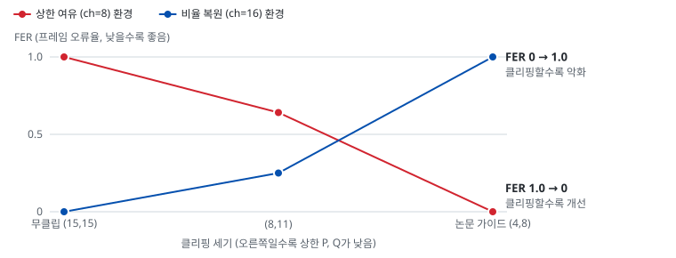
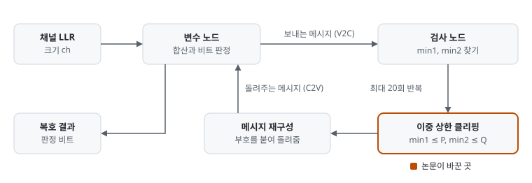
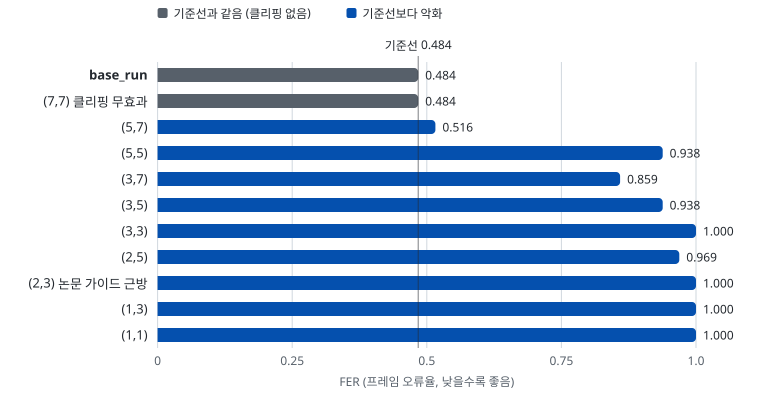
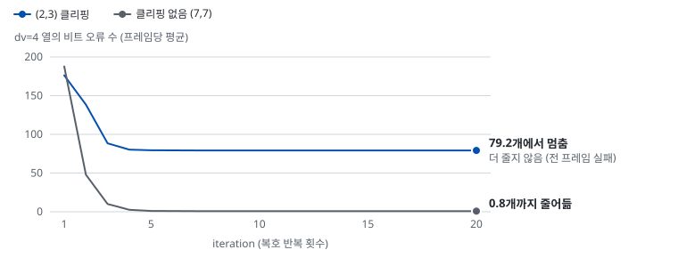

# 001 minsum_dual_clip: CNU min1/min2 이중 상한 클리핑

출처: ieee:9496601 (IEEE TCAD 2022) | 상태: 조건부 유효 (평가 대상 파라미터로 최종 판정 대기)

## 📌 요약

- **논문 아이디어**:
    - min-sum 검사 노드가 돌려주는 가장 작은 값(min1)과 둘째로 작은 값(min2)을
      **서로 다른 상한 P ≤ Q로 잘라냄** (상한 하나보다 둘을 따로 두는 쪽이 낫다는 주장)
    - 배경: min-sum LDPC 디코더의 **검사 노드 연산(CNU, Check Node Unit)**은
      검사식마다 들어온 메시지 크기 중 min1과 min2만 골라 돌려줌. 논문은 min1에
      상한 P, min2에 상한 Q (1 ≤ P ≤ Q)를 둠
- **제안 이유**:
    - 비트 수가 적은 디코더는 반복이 진행될수록 내부 메시지가 채널에서 받은
      정보보다 훨씬 크게 자람 (**과확신**: 메시지가 실제보다 큰 확신을 담는 상태)
    - 초반의 잘못된 확신이 한번 커지면 뒤에서 바로잡기 어려움
    - 상한으로 메시지 성장을 늦추면 잘못된 확신이 굳기 전에 교정할 기회가 남음
- **성공시 효과**:
    - 저비트폭 환경에서 무클립 대비 **FER**(Frame Error Rate, 프레임 오류율) 개선
    - 논문 가이드값은 P = 상한의 1/4, Q = 상한의 1/2 근방
    - 구현 비용은 C++ 기준 min 확정 직후 clip 2줄 (사실상 비용 없음)
- **개선 확인방법**:
    - on/off FER 비교
    - 클리핑이 과할 때 나타나는 **특정 열 오류 동결** 현상을 dv별 오류 로그로 확인
      (dv는 변수 노드 차수, 한 비트가 몇 개의 검사식에 연결되어 있는지)
    - 상세는 아래 평가 계획 표

- **실험 결과**:
    - **판정: 조건부 유효**. 채널 LLR 크기 대비 edge 상한에 여유가 있을 때만 이득:
      여유가 크면 무클립 FER(프레임 오류율) 1.0이 가이드값 (4,8)에서
      FER 0, 여유가 없으면 모든
      클리핑이 악화
    - 여유가 없는 환경(LLR_MATRIX_HD_1, dv별 ch 5/10/13/28, edge 상한 7)에서는
      모든 클리핑이 악화 (E=200 FER 4.84e-01이 가장 약한
      클리핑 (5,7)에서도 5.16e-01)
    - 여유가 큰 환경(균일 ch=8, edge 상한 15)에서는 무클립이 전 프레임 실패(FER
      1.0)하는데 논문 가이드값 (4,8)이 FER 0으로 완전
      복구
    - 같은 P에서 Q를 키우면 모든 환경에서 일관 개선 (이중 상한이
      단일 상한보다 낫다는 논문 주장 재현)
    - 평가 대상 파라미터로 최종 판정 대기. 사전 지표는 dv별 `ch / (edge상한 × dv)`
      비율 (1에 가까우면 클리핑 여지 없음)

## 📄 출처 상세

- **논문**:
    - "A Low Bit-Width LDPC Min-Sum Decoding Scheme for NAND Flash" (IEEE TCAD 2022)
    - 아카이브 ID ieee:9496601
- **핵심 아이디어**:
    - CNU에서 min1, min2를 각각 상한 P, Q로 클리핑하는 이중 상한 구조
    - 저비트폭(예: 3-bit) 디코더의 성능 손실을 완화함

## 📊 평가 계획

| 지표 | 무엇을 판별하는지 | 수집 방법 |
|------|------------------|-----------|
| FER, BER, avg_iter | on/off 최종 성능과 수렴 속도 | 항상 수집 |
| 무클립 쌍의 수치 완전 일치 | 구현 동등성 (클리핑을 무효값으로 두면 base_run과 같아야 함) | 스캔에 무클립 쌍 포함 |
| dv별 비트 오류의 iteration 궤적 | 클리핑 과다로 특정 dv 열이 반전 불능이 되는 오류 동결 탐지 | `log={"bit_err_by_dv"}` |
| 반전 가능 조건 `Q + (dv-1)×P > ch` | 반전 불능 경계의 사전 예측 (extrinsic 최대 합이 채널 LLR 크기 ch를 넘어야 초기 판정을 뒤집을 수 있음) | 실험 전 수식 점검 |

## 🔬 py 스크리닝 실험

### 바꾼 것

| 항목 | 내용 |
|------|------|
| **디코더** | decoder.py의 MinSumDualClipDecoder. 재정의 함수 `_c2v_reconstruct` (C++ 대응: C2V_Cal). P, Q는 클래스 속성 CLIP_P, CLIP_Q로 전달 |
| **설정** | config.json은 base_run과 동일 조건 (seed 0, fixed_error [200, 300], frames_per_batch 64), label만 변경 |
| **(P,Q) 스캔** | scan.py로 실행. config 파일과 쌍 목록을 인자로 받음: `python scan.py [config파일] [P,Q P,Q ...]` |

### 실험 환경 이름

| 번호 | 환경 이름 | config | 채널 LLR 크기 (ch) | edge 상한 | 조건 설명 |
|------|-----------|--------|--------------------|-----------|-----------|
| 1 | **LLR_MATRIX_HD_1 환경** | config.json | LLR 파일 LLR_MATRIX_HD_1.txt (dv별 5/10/13/28) | 7 | 채널 LLR가 edge 상한보다 크거나 비슷해, edge 메시지가 자랄 여유가 없는 조건 |
| 2 | **상한 여유 환경** | config_headroom.json | 균일 8 | 15 | 채널 정보 대비 edge 상한에 여유가 있어 메시지 진폭이 크게 자랄 수 있는 조건 |
| 3 | **비율 복원 환경** | config_balanced.json | 균일 16 | 15 | 상한 여유 환경에서 ch만 8에서 16으로 올려 채널 LLR 크기를 edge 상한과 비슷하게 되돌린 대조 조건. ch 대 edge 상한 비율이 1번 환경처럼 1 근처가 되므로, 이득이 "상한의 여유"에서 오는지를 가림 |

### 준비된 실험 (config 슬롯)

| config | 확인하려는 것 | 채울 슬롯 | 실행 |
|--------|--------------|-----------|------|
| config.json | LLR_MATRIX_HD_1 환경 on/off | 없음 (바로 실행) | `python scan.py` |
| config_headroom.json | 상한 여유 환경 (클리핑 이득 조건 재현) | 없음 | `python scan.py config_headroom.json 15,15 8,11 4,8` |
| config_balanced.json | 비율 복원 환경 (이득 소멸 대조) | 없음 | `python scan.py config_balanced.json 15,15 8,15 4,8` |
| config_target.json | 평가 대상 파라미터 최종 판정 | H_matrix.file, decoder.llr_matrix.file 두 개 | `python scan.py config_target.json 7,7 5,7 3,5 2,3` |

- **config_target.json 사용법**:
    - 평가할 H-matrix와 LLR 파일을 `2_LDPC_base/Input/H_matrix/`,
      `2_LDPC_base/Input/LLR/`에 넣고 파일명 두 개만 채우면 바로 실행됨
    - 스캔에 (7,7)을 포함하면 무클립 기준선이 같은 스캔 안에서 나옴 (3-bit 파일
      기준. edge 상한이 다른 파일이면 무클립 쌍은 (상한, 상한)으로 바꿈)

### 결과

#### 결과 1. LLR_MATRIX_HD_1 환경 (E=200)

> - **조건**: dv별 ch 5/10/13/28, edge 상한 7, 프레임당 에러 200bit
> - **핵심**: (7,7)이 base_run과 수치 완전 일치 (구현 동등성 검증).
>   유효한 클리핑은 전부 악화

| (P,Q) | FER | BER | avg_iter | 비고 |
|-------|-----|-----|----------|------|
| base_run | 4.84e-01 | 2.51e-05 | 12.2 | 기준선 |
| (7,7) 클리핑 무효과 | 4.84e-01 | 2.51e-05 | 12.2 | base_run과 수치 완전 일치 |
| (5,7) | 5.16e-01 | 2.55e-05 | 12.6 | 가장 약한 클리핑도 악화 |
| (5,5) | 9.38e-01 | 1.21e-04 | 19.0 | 악화 |
| (3,7) | 8.59e-01 | 8.61e-05 | 17.9 | 악화 |
| (3,5) | 9.38e-01 | 1.45e-04 | 19.2 | 악화 |
| (3,3) | 1.00e+00 | 2.45e-03 | 20.0 | 전 프레임 실패 |
| (2,5) | 9.69e-01 | 1.81e-04 | 19.6 | 반전 가능 조건에 겨우 걸침 |
| (2,3) 논문 가이드 근방 | 1.00e+00 | 2.40e-03 | 20.0 | 전 프레임 실패 (dv=4 열 반전 불능) |
| (1,3) | 1.00e+00 | 2.42e-03 | 20.0 | 전 프레임 실패 |
| (1,1) | 1.00e+00 | 5.33e-03 | 20.0 | 전 프레임 실패 |

#### 결과 2. 환경 대조 (edge 상한 15, 균일 LLR 생성, E=200 FER)

> - **조건**: 상한 여유 환경(ch=8)과 비율 복원 환경(ch=16), 각 256프레임
> - **핵심**: 무클립이 전 프레임 실패하는 상한 여유 환경에서 논문 가이드 (4,8)이
>   FER 0 (0/256)으로 완전 복구. 비율 복원 환경에서는
>   반대로 (4,8)이 전 프레임 실패
> - **그림**: 요약 절의 그림 2가 이 표를 그린 것임

| 환경 | 무클립 (15,15) | (8,11) | 논문 가이드 (4,8) |
|------|---------------|--------|-------------------|
| 상한 여유 (ch=8) | 1.00e+00 (BER 6.69e-02, 전 프레임 실패) | 6.41e-01 | 0.00e+00 (0/256, 완전 복구) |
| 비율 복원 (ch=16) | 0.00e+00 (0/256, 정상) | 2.50e-01 | 1.00e+00 (전 프레임 실패) |

#### 지표별 해석

1. **반전 가능 조건이 반전 불능 경계를 정확히 예측함** (평가 계획 4행):
    - dv 열의 최대 extrinsic `Q + (dv-1)×P`가 그 dv의 ch보다 작으면 반전 불능
    - LLR_MATRIX_HD_1 환경의 지배 열 dv=4(147개 중 129개)는 ch=10. (2,3)은 최대
      extrinsic 9라 반전 불능(FER 1.0), (2,5)는 11이라 겨우 반전 가능(9.69e-01)
    - dv별 오류 로그(평가 계획 3행)로 직접 확인됨 (그림 5): (2,3)에서 dv=4 오류가
      iteration 5부터 약 79개에서 줄지 않고 iteration 7부터 79.2개로 동결
2. **LLR_MATRIX_HD_1 환경은 클리핑 여지가 없음** (전 클리핑
   악화):
    - dv별 ch(10/13/28)가 edge 상한 7 기준 반전 조건에 빠듯하게 맞춰져 있음
    - dv=2는 ch=28 > 14라 무클립에서도 반전 불능 (알려진 위반)
3. **상한 여유 환경에서는 논문의 이득 조건이 재현됨**:
    - 무클립이 과확신으로 전 프레임 실패하는 조건에서 논문 가이드값(P=상한/4,
      Q=상한/2)이 FER 1.0을 0으로 되돌림
    - 논문의 이득 조건은 "내부 진폭이 채널 LLR보다 크게 성장하는 저비트폭 환경"
4. **이중 상한이 단일 상한보다 나음**: 같은 P에서 Q를 키우면 모든 환경에서 일관
   개선 (논문의 구조 주장 방향 재현)

## ✅ 결론

- **판정: 조건부 유효**
- **근거**: 클리핑의 득실은 **채널 LLR 크기 대비 edge magnitude 상한의 여유**가 결정함
    1. 여유가 없으면 (LLR_MATRIX_HD_1 환경, 비율 복원 환경) 클리핑은 반전 가능성만
       깎아 악화시킴
    2. 여유가 커서 무클립이 과확신으로 전 프레임 실패하는 환경(상한 여유 환경)에서는
       논문 가이드값이 FER 1.0을 0으로 되돌림
    3. 이중 상한(P<Q)이 단일 상한(P=Q)보다 낫다는 논문 주장은 모든 환경에서 방향 재현
- **판정 사전 지표**: 평가할 LLR set의 dv별 `ch / (edge상한 × dv)` 비율이 1에
  가까우면 클리핑 여지가 없고, 낮으면 (P,Q) 스캔 가치가 있음

## ⏭ 후속

- 평가 대상 파라미터로 config_target.json 스캔을 돌려 최종 판정
- 판정 기준: 결론의 사전 지표로 클리핑 여지를 먼저 보고, 스캔에서 무클립 대비
  개선이 나오면 유효로 판정함
