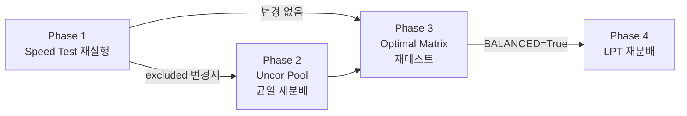

# DAO Speed Test & 코어 부하 분산 업데이트

> 기간: 2026-02 ~ 2026-04 / 대상: DAO 사용자

## 배경 — 왜 필요했나

DAO는 MPI 기반 병렬 처리 엔진으로, 모든 코어가 동시에 디코딩을 수행한 뒤 `MPI_Barrier()`에서 합류한다.
이 구조에서 **한 코어만 느려도 전체가 그 코어를 기다린다.**

슈퍼컴 클러스터에서 실제로 발생한 문제:

- **노드 간 성능 편차**: 동일 사양이라도 다른 Job과의 자원 경합으로 특정 코어가 2~3배 느려지는 경우 빈번
- **Uncor 분배 불균형**: Uncor 개수를 균등 분배하더라도, uncor별 디코딩 iteration 수가 크게 달라 코어 간 실제 소요 시간 편차 발생
- **장시간 실행 중 상태 변화**: 수 시간~수 일 실행 중 노드 부하가 변동하지만 초기 1회 측정만으로는 대응 불가

이 문제들을 해결하기 위해 Speed Test 체계와 부하 분산 알고리즘을 단계적으로 도입했다.

---

## 변경 요약

| # | 변경 | 문제 | 해결 |
|---|------|------|------|
| 1 | Core Speed Test | 느린 코어가 전체를 병목 | 사전 측정 → 느린 코어 자동 제외 |
| 2 | Uncor Pool 병렬화 | root 직렬 복사 병목 | 코어별 pool 사전 분배 → 병렬 로드 |
| 3 | LPT 균등 분배 | uncor 개수 균등 ≠ 시간 균등 | iteration 비용 기반 분배 |
| 4 | 주기적 Recheck | 1회 측정 → 장시간 후 무효화 | stage/시간 기반 주기적 재측정+재분배 |

---

## 1. Core Speed Test — 느린 코어 자동 제외

### 문제

클러스터에서 일부 코어가 2~3배 느리면, `MPI_Barrier()`에서 나머지 코어가 유휴 대기한다.
코어 100개 중 1개만 느려도 전체 throughput이 그 1개 수준으로 떨어진다.

### 해결

최적화 시작 전 모든 코어가 동일 조건(고정 시드)으로 짧은 디코딩 테스트를 실행하고, 평균 대비 일정 비율 이상 느린 코어를 자동 제외한다.

```
[시작] → 모든 코어에 동일 시드 테스트 실행
      → allgather로 소요 시간 수집
      → 코어별로 "자신을 제외한 평균"과 비교
      → 평균 × CUTOFF_RATIO 초과 시 excluded_cores에 등록
      → 이후 최적화에서 제외 코어는 참여하지 않음
```

### 설정

| 파라미터 | 기본값 | 설명 |
|----------|--------|------|
| `ENABLE_CORE_SPEED_TEST` | `True` | 기능 활성화 |
| `CORE_SPEED_CUTOFF_RATIO` | `2.0` | 평균 대비 N배 느리면 제외 |

---

## 2. Uncor Pool 병렬화 — 직렬 복사 병목 제거

> **Uncor Pool이란?** 각 코어의 로컬 디렉토리(`uncor_pool/`)에 uncor 파일을 사전 분배해 둔 저장소. 모드 전환 시 root를 거치지 않고 각 코어가 자신의 pool에서 바로 로드한다.

### 문제

기존: 모드 전환 시 root(rank 0)가 uncor 파일을 **순차적으로** 각 코어에 복사.
코어 수가 많을수록 대기 시간이 선형 증가한다.

### 해결

Speed test 직후 각 active core의 `uncor_pool/` 디렉토리에 1회 사전 분배.
이후 모드 전환 시 각 코어가 자신의 pool에서 **동시에** 병렬 복사한다.

```
[As-Was]  root → core1 → core2 → core3 → ... (순차)

[To-Be]   Setup_Uncor_Pool() — 1회 사전 분배
            ↓
          모드 전환 시:
            core1: pool → local (동시)
            core2: pool → local (동시)
            core3: pool → local (동시)
```

---

## 3. LPT 균등 분배 — 시간 기준 부하 분산

### 문제

Uncor를 개수 기준으로 균등 분배하면, iteration이 많은 uncor가 몰린 코어만 느려진다.
예: 코어 A에 iteration 500짜리 3개, 코어 B에 iteration 50짜리 3개 → A가 10배 오래 걸림.

### 해결

Initial test에서 uncor별 iteration 수를 측정한 뒤, **LPT(Longest Processing Time first)** 알고리즘으로 재분배한다. 추가로 코어별 `speed_factor`를 곱하여 실제 소요 시간을 기준으로 분배한다.

```
LPT 알고리즘:
  1. uncor를 iteration 수 내림차순 정렬
  2. 현재 "예상 총 시간"이 가장 작은 코어에 할당
  3. 예상 시간 = iteration × (1 / speed_factor)
  → 코어 간 디코딩 시간 편차 최소화
```

### 설정

| 파라미터 | 기본값 | 설명 |
|----------|--------|------|
| `ENABLE_BALANCED_UNCOR_DISTRIBUTION` | `True` | LPT 분배 활성화 |

---

## 4. 주기적 Recheck — 장시간 실행 대응

### 문제

Speed test를 시작 시 1회만 수행하면, 실행 중 노드 부하 변동에 대응할 수 없다.
몇 시간 후 특정 코어가 느려져도 계속 참여시키거나, 복구된 코어를 계속 제외하게 된다.

### 해결

두 가지 트리거로 주기적 재측정 + 재분배를 수행한다.

### 4-1. Stage 기반 Recheck (RUN_OPTIMIZATION)

N stage마다 4단계 Phase를 실행한다:



- Phase 2는 excluded_cores가 변경된 경우에만 실행 (불필요한 재분배 방지)
- Phase 3~4는 `ENABLE_BALANCED_UNCOR_DISTRIBUTION=True`일 때만 실행

| 파라미터 | 기본값 | 설명 |
|----------|--------|------|
| `RECHECK_INTERVAL_STAGES` | `0` | 0=비활성, N=N stage마다 |

### 4-2. 시간 기반 Recheck (trial 내부)

장시간 실행되는 trial/candidate 루프 내부에서 경과 시간 기준으로 재측정한다.

| 파라미터 | 대상 모드 | 기본값 |
|----------|-----------|--------|
| `RECHECK_INTERVAL_SECONDS` | RUN_OPTIMIZATION trial | `0` (비활성) |
| `SPEED_TEST_RECHECK_INTERVAL_SECONDS` | GEN_SINGLE_ROW | `7200` (2시간) |

- root가 경과 시간 판단 → bcast 동기화 (MPI desync 방지)
- 강제 종료 확정 시 불필요한 speed test 스킵

---

## 5. 버그 수정 & 엣지 케이스 처리

| 문제 | 원인 | 수정 |
|------|------|------|
| root(rank 0)가 speed test에서 제외되면 MPI 통신 오류 | 모든 rank를 동일 기준으로 제외 판정 | rank 0은 제외 대상에서 보호 |
| `gather`로 수집 시 root만 결과 보유 → 다른 rank에서 디버그 정보 접근 불가 | `comm.gather` 사용 | `comm.allgather`로 교체 |
| GEN_SINGLE_ROW에서 카운트 기반 주기가 실행 속도에 따라 불규칙 | `RANKING_UPDATE_INTERVAL` 횟수 기반 | 시간 기반(`SPEED_TEST_RECHECK_INTERVAL_SECONDS`)으로 교체 |
| 강제 종료 확정 후에도 speed test 실행 → 결과를 활용하지 못하는 시간 낭비 | 종료 플래그 미확인 | `is_forced_termination=True` 시 스킵 |

---

## 전체 설정 레퍼런스

```python
# ── 코어 속도 테스트 ──
class SPEED_TEST_REFC_CONFIG(REFC_CONFIG):
    ENABLE_CORE_SPEED_TEST = True        # 기능 on/off
    CORE_SPEED_CUTOFF_RATIO = 2.0        # 평균 대비 N배 → 제외
    RECHECK_INTERVAL_STAGES = 0          # 0=비활성, N=N stage마다
    RECHECK_INTERVAL_SECONDS = 0         # 0=비활성, N=N초마다

# ── Uncor 균등 분배 ──
class UNCOR_CONFIG:
    ENABLE_BALANCED_UNCOR_DISTRIBUTION = True  # LPT 분배 on/off

# ── GEN_SINGLE_ROW 전용 ──
class SINGLE_ROW_CONFIG:
    ENABLE_PERIODIC_SPEED_TEST = True              # 주기적 speed test on/off
    SPEED_TEST_RECHECK_INTERVAL_SECONDS = 7200     # 재측정 주기 (초)
```

---

## 개발 타임라인

| 날짜 | 구분 | 내용 |
|------|------|------|
| 02-03 | **신규** | **Core Speed Test 최초 구현.** 클러스터에서 특정 노드가 2~3배 느린데 모든 코어를 동일 취급하던 문제 해결. 고정 시드로 사전 측정 → 느린 코어 자동 제외 |
| 02-03 | 개선 | `SPEED_TEST_REFC_CONFIG` 클래스 분리 — 측정 조건을 본 설정과 독립적으로 관리 |
| 02-05 | 신규 | Speed test 활성화 + `CUTOFF_RATIO` 설정 추가 (평균 대비 N배 기준 조절 가능) |
| 02-06 | 수정 | Speed test 일시 비활성화 — 초기 안정화 과정에서 부작용 확인 후 조건부 적용으로 전환 |
| 02-20 | **신규** | **Uncor Pool 병렬화.** 모드 전환 시 root 순차 복사 → `uncor_pool/` 사전 분배 + 각 코어 병렬 로드로 교체. 코어 수에 비례하던 병목 제거 |
| 02-20 | 신규 | Stage 기반 주기적 Speed Test 재실행 (`RECHECK_INTERVAL_STAGES`). 초기 1회 측정만으로는 장시간 실행 중 노드 부하 변동에 대응 불가했던 문제 해결 |
| 03-18 | **신규** | **LPT 알고리즘 균등 재분배.** uncor 개수 균등 ≠ 시간 균등 문제 확인 → iteration 비용 기반 분배 도입. `speed_factor` 곱하여 코어 속도 차이까지 반영 |
| 03-18 | 수정 | `gather→allgather` 교체 — 디버그 정보를 모든 rank가 접근 가능하도록 수정 |
| 03-24 | 수정 | root(rank 0) 제외 방지 — root가 speed test에서 빠지면 MPI 통신 오류 발생하던 버그 수정 |
| 03-26 | **신규** | **Periodic Recheck 4-Phase 구조 확립.** 재측정 → 균일 분배 → 재테스트 → LPT 재분배를 하나의 파이프라인으로 통합 |
| 03-30 | 신규 | GEN_SINGLE_ROW 모드에 주기적 Speed Test 확장 + end flag graceful stop |
| 04-02 | 신규 | 시간 기반 주기적 Speed Test. 기존 카운트 기반 → `RECHECK_INTERVAL_SECONDS`로 교체. 실행 속도와 무관하게 일정 간격 재측정 |
| 04-02 | 수정 | 강제 종료 확정 시 speed test 스킵 — 결과를 활용 못하는 불필요한 시간 낭비 제거 |
| 04-03 | 최적화 | excluded_cores 미변경 시 재분배 스킵 — 불필요한 pool 재구성 방지 |
